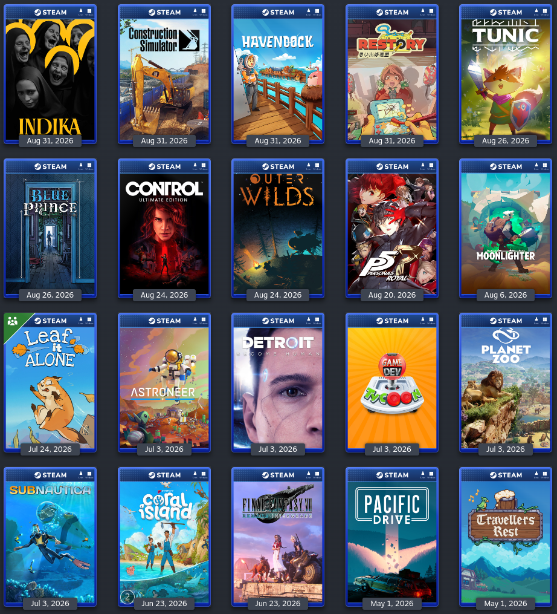

<div align="center">


# Case Covers

**Give every game in your Steam library a "physical copy" case cover.**<br>
29 platform frames, from PlayStation and Xbox to Game Boy and Dreamcast, with backup and one-click restore.


[**⬇ Download**](../../releases/latest) · [Features](#features) · [Installation](#installation) · [Usage](#usage) · [Development](#development) · [Detailed notes](docs/DETAILS.md)



</div>

---

> [!NOTE]
> Case Covers is not affiliated with Valve, Sony, Microsoft, Nintendo, Sega or any game publisher. Platform names and logos are trademarks of their owners; see [THIRD_PARTY.md](THIRD_PARTY.md).

## Features

| | |
|---|---|
| 🎮 **29 platform frames** | 600 × 900 case frames for PlayStation 1–5, PSP, PS Vita, Xbox to Xbox Series X\|S, NES to Switch 2, Game Boy to 3DS, Master System, Mega Drive, Saturn, Dreamcast and Steam. |
| 📚 **Library** | Finds installed Steam games and existing Non-Steam shortcuts automatically; import `userdata.json` to include games you don't have installed. |
| 🔎 **Search** | Find any game by name, independently of Steam. You always pick the exact match; nothing is guessed. |
| 🖼 **Artwork sources** | Steam's own portraits (no key needed), SteamGridDB with your personal API key, or a local PNG/JPG/WebP image. |
| ✏️ **Cover Editor** | Shows the current Steam cover beside the final framed preview before you change anything. |
| 📦 **Batch** | Queue many covers, then apply them with one backup and at most one Steam restart, or export them all as PNG. Automatic generation joins the same queue. |
| 💾 **Backup** | Export and import every locally stored custom portrait for a Steam account, shortcuts included, with a safety backup. |
| ↩️ **Undo** | Restore steps back one Apply at a time; Reset returns to Steam's default art. |
| 🛡 **Data safety** | Only portrait files in `config/grid` are touched; `shortcuts.vdf` is only read. API keys live in the OS credential store. Downloads are HTTPS-only, size-limited and checked. |

## Installation

### Ready-made build (recommended)

Download the file for your system from the [latest release](../../releases/latest):

| System | File | Notes |
|---|---|---|
| **Windows** | `CaseCovers-Setup-windows.exe` | Installer: per-user, no administrator rights; updates keep your settings and API key. |
| **Windows** | `CaseCovers-windows.exe` | Portable: just double-click it. |
| **macOS** | `CaseCovers-macos.zip` | Apple Silicon (M1 or newer). |
| **Linux / Steam Deck** | `CaseCovers-linux` | On a Steam Deck, use Desktop Mode. |

> [!NOTE]
> The builds are not code-signed. On Windows, SmartScreen may warn on first launch: **More info → Run anyway**. On macOS, run `xattr -dr com.apple.quarantine ~/Downloads/CaseCovers.app` in Terminal before opening the app. Step-by-step help is in the [detailed notes](docs/DETAILS.md#installation-help).

Every release has a `SHA256SUMS` file and signed build provenance, so you can check what you downloaded. See [SECURITY.md](SECURITY.md).

### From source

1. Install [Python 3.11 or newer](https://www.python.org/downloads/) (3.12 is used for releases).
2. Download or clone this repository.
3. Install the dependencies and start the app:

```bash
python -m pip install -r requirements.txt
python qt_gui.py
```

On macOS and Linux, use `python3`. The previous Tkinter app is still available with `python gui.py`.

## Usage

### Getting started

1. **Choose a game.** **Library** lists your installed Steam games and shortcuts. For the rest of your library, click **Download your game list**, sign in to Steam in your browser, save the page as `userdata.json` and click **Load userdata.json**. Use **Search** for a game outside your Steam library.
2. **Choose artwork and a frame.** Click a portrait thumbnail or import your own image, then pick one of the 29 platform frames. The Cover Editor updates the final preview.
3. **Apply or export.** **Apply to Steam** changes one game, **Add to batch** queues it, and **Export PNG** saves the cover without touching Steam.

> [!WARNING]
> Apply closes Steam if it is running (a running game stops and downloads pause), backs up the art it changes and can start Steam again. Save your game first; the app always asks before it does anything.

> [!NOTE]
> Steam artwork needs no API key. For SteamGridDB, add your personal key under **Settings**; it is stored only in the OS credential store (Windows Credential Manager, macOS Keychain or the Linux secret service), never in a settings file.

### Views

| View | What it is for |
|---|---|
| **Library** | Your Steam games and shortcuts, with live search, category filters and the Cover Editor. |
| **Search** | Find a game by name and pick the exact result; uses the same artwork grid and editor. |
| **Batch** | The queue: **Apply all to Steam**, **Export all PNGs** and **Generate all covers**. |
| **Backup** | Export, preview and import portrait artwork; **Restore previous artwork** and **Reset to Steam default**. |
| **Settings** | SteamGridDB API key and app preferences. |

### Where your data lives

| System | Covers folder |
|---|---|
| Windows | `%LOCALAPPDATA%\steamcase\covers` |
| macOS | `~/Library/Application Support/steamcase/covers` |
| Linux | `~/.local/share/steamcase/covers` |

Steam's copies live in `userdata/<id>/config/grid`, next to the backups the app makes (`grid_backup_*`). Logs are in `%LOCALAPPDATA%\Case Covers\logs` on Windows and `~/.local/state/case-covers` on other systems; they never contain API keys.

> [!TIP]
> Changed your mind? **Restore previous artwork** undoes the last Apply; press it again to go further back. **Reset to Steam default** removes the covers this app made; enable **Reset all custom portraits** to also remove art from other sources.

### Known limitations

- Steam may show cached artwork until the client refreshes.
- Some older games have no real portrait on Steam, only a blurry stand-in; tick **Skip blurry Steam artwork** in Batch to leave them alone.
- Screen readers are not supported; the window works fully with the keyboard, and the [command line](docs/DETAILS.md#command-line) is the accessible alternative.

More answers are in the [FAQ](docs/DETAILS.md#faq).

## Development

### Run from source

```powershell
py -3.12 -m venv .venv
.venv\Scripts\python.exe -m pip install -r requirements-build.txt
.venv\Scripts\python.exe qt_gui.py
```

### Tests

```powershell
.venv\Scripts\python.exe -m unittest discover -s tests
.venv\Scripts\python.exe qt_gui.py --selftest
.venv\Scripts\python.exe gui.py --selftest
```

The tests use temporary Steam folders and a local test server; they never touch your real Steam data or need an API key.

### Build

```powershell
powershell -NoProfile -ExecutionPolicy Bypass -File tools\build_windows.ps1 -Installer
```

1. Stamps the latest release tag as the version.
2. Builds `dist\CaseCovers.exe` with PyInstaller and runs its selftest.
3. With `-Installer`, compiles the Inno Setup 6 installer and smoke-tests a silent install, the installed selftest and an uninstall.
4. Moves the verified installer to `build\installer\`; a failed check keeps the previous one.

### Releases

Pushing a `vX.Y.Z` tag runs [`.github/workflows/release.yml`](.github/workflows/release.yml). It tests and builds Windows, macOS and Linux, smoke-tests the Windows installer, and publishes everything with checksums and signed provenance on the Releases page. GitHub Releases are the only distribution channel.

### Project layout

```text
qt_gui.py              Main PySide6 window: Library, Search, Batch, Backup, Settings
gui.py                 Tkinter fallback with the original three-step workflow
steamcase.py           Steam discovery, rendering, apply, backup, restore and the CLI
cover_workflow.py      Artwork search, cache, credentials and platform export
case_service.py        Single and batch workflows for both GUIs; preferences and queue
platform_catalog.py    Loads platforms/catalog.json (data only)
crash_report.py        Python and native crash logs
platforms/catalog.json 29 platform definitions
assets/frames/         600 × 900 transparent case frames
assets/logos/          Platform logo variants (see THIRD_PARTY.md)
tools/                 Frame, icon and preview builders, Windows build and installer
tests/                 Unit, GUI and fuzz tests
```

Project rules and the development workflow are in [`AGENTS.md`](AGENTS.md). Frame architecture: [docs/stages-1-to-3.md](docs/stages-1-to-3.md). Search and export: [docs/manual-workflow.md](docs/manual-workflow.md).

## Changelog

### Unreleased

- New PySide6 app with **Library**, **Search**, **Batch**, **Backup** and **Settings** views and a shared Cover Editor.
- 29 platform frames with local logo variants; SteamGridDB artwork with a key stored in the OS credential store.
- Windows installer, persistent crash logs and a renamed app: Case Covers.

### 1.1.0

- Layout follows the real text size; account picker for several Steam accounts; Reset can also remove art from other sources.

All versions are in [CHANGELOG.md](CHANGELOG.md).

## Acknowledgments

Thanks to [SteamGridDB](https://www.steamgriddb.com) and its community, and to the authors of [Pillow](https://python-pillow.org), [PySide6](https://doc.qt.io/qtforpython-6/), [PyInstaller](https://pyinstaller.org), [Inno Setup](https://jrsoftware.org/isinfo.php), the [Nunito Sans](https://fonts.google.com/specimen/Nunito+Sans) font and the KDE Breeze icon theme. Details are in [THIRD_PARTY.md](THIRD_PARTY.md).

Game artwork belongs to its publishers and developers. Covers you generate contain that artwork: keep them for personal use.

## License

Copyright (C) 2026 Diego Bergonsi. Free software under the [GNU General Public License v3 or later](LICENSE).
